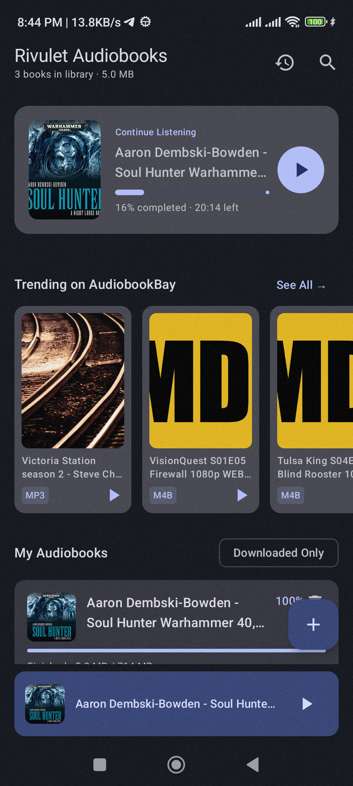
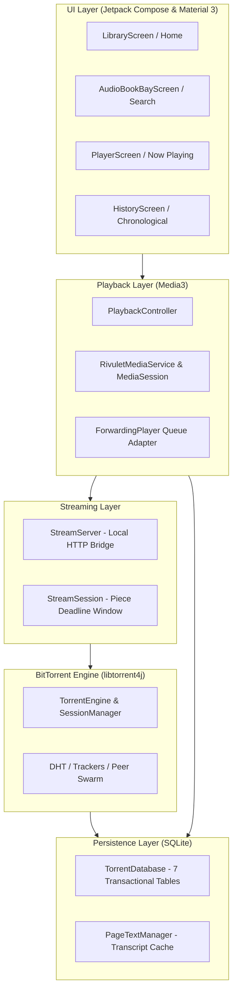

# AudioTorrent

<p align="center">
  
</p>

<p align="center">
  <strong>A modern, high-performance Android audiobook player powered by sequential BitTorrent streaming.</strong>
</p>

<p align="center">
  
  
  
  
  
  
</p>

---

## Highlights

**AudioTorrent** is an audio-first BitTorrent streaming client and dedicated audiobook player for Android. Instead of waiting hours for massive multi-gigabyte audiobooks to download, AudioTorrent utilizes sequential piece scheduling and an embedded local HTTP loopback bridge to begin playback within seconds.

---

## Key Features

### ⚡ Sequential Torrent Streaming
- **Instant Playback**: Employs `libtorrent4j` (libtorrent C++ engine) with sliding read-ahead piece windows and priority prioritization (`Priority.TOP_PRIORITY`).
- **Embedded Loopback Server**: An embedded NanoHTTPD streaming server serves HTTP range requests directly from libtorrent disk storage into Media3 ExoPlayer.
- **Smart MP4 / M4B Atom Protection**: Automatically prioritizes trailing pieces (`moov` atom) so chapters and metadata parse instantly without stalling.
- **Priority-Preserving Stream Leases**: Switching chapters or pausing keeps explicit offline download preferences intact.

### 📚 Audiobook Discovery & Search
- **AudiobookBay Integration**: Direct search, trending shelf, and book details with magnet scraper.
- **1-Press Keyboard Search**: Soft-keyboard `ImeAction.Search` directly triggers query execution and dismisses keyboard.
- **Interactive Recent Searches**: Recent search history shelf with 1-tap re-querying, single deletion, and clear-all.
- **"Want to Listen" Wishlist**: Save books from search or details to your personal offline wishlist shelf.

### 🎧 Dedicated Audiobook Player Experience
- **Audible-Inspired Home**: Hero card with last-listened book, chapter progress, and 1-tap direct resume.
- **In-Player Chapter Queue**: Modal bottom sheet showing all audio files, live chapter progress, and 1-tap track jumping.
- **Natural Chapter Sorting**: Intelligent numerical tokenization sorting (`Chapter 2` plays before `Chapter 10`).
- **Cross-Chapter Bookmarks**: Save timestamped bookmarks with custom notes; tapping any bookmark jumps directly to that chapter and seeks to the exact millisecond.
- **Configurable Jump Controls**: Toggle between `-10s / +30s` and `-15s / +30s` skip intervals.
- **System & Bluetooth Integration**: Foreground `MediaSessionService` wrapped with Media3 `ForwardingPlayer`—lockscreen controls, notifications, Bluetooth earphones, and Android Auto advance and rewind chapters seamlessly.

### 🔊 Advanced Audio Engineering
- **Smart Silence Trimming**: Native ExoPlayer silence-skipping toggle chip (`skipSilenceEnabled`).
- **Voice Boost**: Hardware-accelerated `LoudnessEnhancer` to amplify soft narrators in noisy environments.
- **Fine-Grained Speed Control**: 0.5× to 3.0× modal slider dialog with `±0.1×` stepper buttons and quick presets.
- **Sleep Timer with Volume Fade-Out**: Timer with track-end option and a smooth 30-second linear volume fade-out.

### 📜 Synchronized Text & Lyrics
- **Multi-Format Support**: Automatically parses `.lrc`, `.srt`, `.epub`, and `.txt` companion files.
- **Word-Paced Timing Engine**: Fallback natural-speech timing engine for plain text with safe duration bounds.
- **Rolling Sliding-Window Cache**: 3-page memory cache bounded per track to prevent memory bloat on large books.
- **Spotify-Style Lyrics Drawer**: Active sentence glowing transcript with 1-tap sentence seek.

---

## Architecture & Tech Stack



- **Language**: Kotlin 2.3.20 (JDK 17)
- **UI Toolkit**: Jetpack Compose, Material 3, Navigation3
- **Media Engine**: AndroidX Media3 1.11.1 (ExoPlayer & MediaSessionService)
- **Torrent Core**: `org.libtorrent4j:libtorrent4j:2.1.0-35`
- **Networking & Scraping**: OkHttp 4.12.0, Jsoup 1.18.3, Coil 2.7.0 (AsyncImage)
- **Database**: Android SQLite (`DATABASE_VERSION = 5`) with transactional cascading deletes

---

## Getting Started

### Prerequisites
- Android Studio Ladybug / Meerkat or newer
- JDK 17
- Android SDK Platform 36 (minSdk 26, targetSdk 36)

### Build from Source

```bash
# Clone the repository
git clone https://github.com/rabit314/AudioTorrent.git
cd AudioTorrent

# Run unit tests
./gradlew test

# Run Android Lint (0 errors verified)
./gradlew lintDebug

# Build Debug APK
./gradlew assembleDebug
```

The compiled APK will be generated at `app/build/outputs/apk/debug/app-debug.apk`.

### Deploy to Device via ADB

```bash
adb install -r app/build/outputs/apk/debug/app-debug.apk
adb shell am start -n com.example.rivulet/.MainActivity
```

---

## Security & Privacy

- **No Trackers or Analytics**: AudioTorrent respects your privacy—zero telemetry, zero third-party ads, zero tracking SDKs.
- **Credential Safety**: No passwords, keystores, or private signing keys are bundled or committed.
- **Local Storage**: All listening history, bookmarks, and database records remain purely local on your device.

---

## Multi-AI Collaboration Protocol

This project utilizes a structured multi-agent collaboration framework documented under the [`AI/`](AI/) directory:
- [`AI/README.md`](AI/README.md) — Collaboration protocol and entry points.
- [`AI/PROJECT.md`](AI/PROJECT.md) — Project scope and functional specifications.
- [`AI/ARCHITECTURE.md`](AI/ARCHITECTURE.md) — Component interactions and subsystem boundaries.
- [`AI/TASKS.md`](AI/TASKS.md) — Real-time task tracking and verification logs.
- [`AI/HANDOFF.md`](AI/HANDOFF.md) — Latest operational handoff and environment snapshot.

---

## License & Legal Disclaimer

AudioTorrent is intended strictly for personal streaming of authorized or public-domain audiobooks and legally shareable content. Users are solely responsible for ensuring compliance with copyright laws in their respective jurisdictions.
