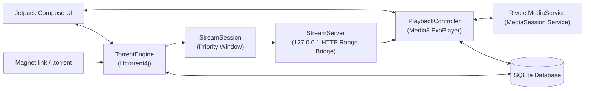

<div align="center">


# AudioTorrent

**A high-performance, audio-first BitTorrent streaming client for Android.**

Listen to audiobooks, albums, podcasts, and long-form audio instantly while they download.

[](https://github.com/rabit314/AudioTorrent/releases/latest)
[-3DDC84?style=flat-square&logo=android&logoColor=white)](https://developer.android.com/about/versions/oreo)
[](https://kotlinlang.org)
[](https://developer.android.com/jetpack/compose)
[](https://github.com/frostwire/frostwire-jlibtorrent)
[](https://developer.android.com/media/media3)

[Download Beta APK](#-download-beta-release) · [Features](#-features) · [Architecture](docs/ARCHITECTURE.md) · [Building](docs/BUILDING.md) · [Contributing](CONTRIBUTING.md) · [Report Bug](https://github.com/rabit314/AudioTorrent/issues/new?template=bug_report.yml)

</div>

---

## 📥 Download Beta Release

Get the latest installable pre-release APK directly for your Android phone or tablet:

<p align="center">
  <a href="https://github.com/rabit314/AudioTorrent/releases/download/v0.3.0-beta/AudioTorrent.apk">
    
  </a>
  &nbsp;&nbsp;
  <a href="https://github.com/rabit314/AudioTorrent/releases">
    
  </a>
</p>

> [!TIP]
> **Installation Instructions:**
> 1. Download **[`AudioTorrent.apk`](https://github.com/rabit314/AudioTorrent/releases/download/v0.3.0-beta/AudioTorrent.apk)** directly to your device.
> 2. Open the downloaded file. When prompted, allow your browser or file manager to *"Install unknown apps"*.
> 3. Launch AudioTorrent from your app drawer.
> 4. **Compatibility**: Requires **Android 8.0 (API 26)** or newer. Bundled native libraries support both **`arm64-v8a`** and **`x86_64`** devices.

---

## ✨ Features

- ⚡ **Stream as You Download** — Open magnet links or `.torrent` files and start listening within seconds. A custom loopback HTTP range bridge and dynamic piece scheduler stream files ahead of time while prioritizing MP4 metadata tails.
- 🎧 **Audiobook-Optimized Playback** — Pick up where you left off with smart pause auto-rewind, adjustable speed (0.5× to 3.0×), Voice Boost, a seek bar, and fixed −10s/+30s controls. Cover and text share one panel above the playback controls, with a two-column landscape layout.
- 📑 **Natural Chapter Queuing** — Multi-file audiobooks sort naturally (`Chapter 1`, `Chapter 2`, ..., `Chapter 10`), with seamless auto-advance across tracks, unified chapter drawer, and persistent bookmarks with personal notes.
- 📚 **Audiobook Discovery** — Built-in AudiobookBay integration with trending feeds, audio-only media filtering, search history, and instant magnet resolution.
- 📖 **Companion Read-Along (Beta)** — Find an ebook through native Z-Library results with cover thumbnails, or import EPUB, TXT, LRC, and SRT files. English narration matching runs on the phone with a separately downloaded 60 MB model. Text options contains edition replacement, track selection, chapter hints, and sync adjustments. Includes sentence highlighting, tap-to-seek, and Follow narration; temporary estimated timing is offered only when matching is unavailable.

To correct highlighting without moving the audio, open **Text → Correct sync**, select the sentence being narrated, and press **Sync now** when it begins. Untimed sentences guide a local narration match. **Undo correction** restores the previous adjustment; normal sentence taps still seek outside correction mode.
- 💾 **Offline Library Management** — Download individual chapters or entire audio torrents to local storage with automated offline persistence.
- 🔔 **Media3 Foreground Service** — Complete background audio playback with lock screen album art, interactive notification with live Play/Pause toggles, and Bluetooth headset controls.

---

## 🏗️ Architecture

AudioTorrent is built as a single-module Android application using modern Android Jetpack libraries and native BitTorrent libraries:



For detailed component documentation, data models, and stream lifecycle behavior, refer to [**docs/ARCHITECTURE.md**](docs/ARCHITECTURE.md).

---

## 🛠️ Building from Source

### Prerequisites
- **JDK 17** (configured Java toolchain)
- **Android SDK Platform 36** and Build Tools
- A connected Android device or emulator running **Android 8.0+** (`arm64-v8a` or `x86_64`)

### Build Commands

Clone the repository:
```bash
git clone https://github.com/rabit314/AudioTorrent.git
cd AudioTorrent
```

Run tests and assemble the debug APK:
- **macOS / Linux:**
  ```bash
  ./gradlew :app:testDebugUnitTest :app:lintDebug :app:assembleDebug
  ```
- **Windows (PowerShell):**
  ```powershell
  .\gradlew.bat :app:testDebugUnitTest :app:lintDebug :app:assembleDebug
  ```

The generated APK will be at `app/build/outputs/apk/debug/app-debug.apk`. For comprehensive build configuration and release signing details, check [**docs/BUILDING.md**](docs/BUILDING.md).

---

## 🤝 Contributing

Contributions, bug reports, and suggestions are welcome!
- Review [**CONTRIBUTING.md**](CONTRIBUTING.md) for code conventions, workflow, and pull request guidelines.
- Report issues or request enhancements via [**GitHub Issues**](https://github.com/rabit314/AudioTorrent/issues).

---

## ⚖️ License & Legal Notice

AudioTorrent is distributed as open-source software under its respective project terms. Dependencies retain their individual licenses (AndroidX, Media3, libtorrent4j, Coil, Jsoup, OkHttp).

> [!CAUTION]
> AudioTorrent is an open-source BitTorrent client designed for public domain, Creative Commons, and legally authorized audio media. Please respect copyright laws and utilize AudioTorrent only with content you have the right to download and stream.
