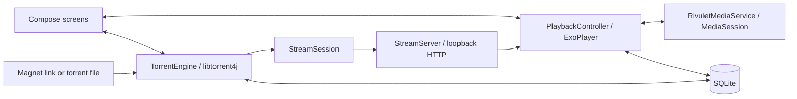

# Architecture

AudioTorrent is a single-module Android app. The source package is `com.example.rivulet`; `RivuletApp` wires the application container, torrent engine, database, stream server, and playback controller.

## Playback flow

`StreamSession` maps file offsets to torrent pieces and schedules a read-ahead window. `StreamServer` is a custom socket-based HTTP range server bound to `127.0.0.1`, with a per-server token in stream URLs. ExoPlayer consumes that local stream. MP4/M4B tail pieces receive additional priority to help load metadata.

`PlaybackController` coordinates playback requests, chapter queues, resume positions, bookmarks, speed, and sleep timers. `RivuletMediaService` connects playback to Android's foreground media service and system media controls.

## Catalog discovery and companion text

`AudioCatalogSearch` queries AudiobookBay and LibriVox independently, tracks each source's pages/errors, publishes partial results and rejects obsolete requests. `AudiobookSearchScreen` presents source filters and provider-labelled recordings. The existing home trending shelf remains AudiobookBay-specific.

`LibriVoxClient` reads the official API and resolves a recording's Internet Archive torrent. Import maps every section to a unique real torrent file index before saving. `BookCatalogMetadata` retains provider identity, source-text link and ordered chapter manifest in private preferences, alongside legacy title entries. Queues and whole-book offline downloads use that manifest, excluding alternate encodings. SQLite remains version 8.

LibriVox audio uses the existing torrent engine. `PublicWebseedBridge` exposes a token-protected loopback BEP19 webseed for registered torrent paths, forwards bounded byte ranges to Archive over Android's HTTPS client, and leaves piece hashing, storage, priorities and playback to libtorrent. This avoids native TLS failures and cross-file redirect limits without adding a separate direct-MP3 transport. Current Archive HTTPS origin roots persist with the recording; the canonical Archive endpoint remains available for redirects. The bridge has bounded concurrency, validates upstream ranges/hosts, rejects unregistered paths, and is recreated on restart. Missing/stale torrents or unavailable Archive files can still prevent playback. Unpublished LibriVox projects without audio links are excluded; pagination counts the raw feed so filtering cannot hide later pages.

Torrent metadata reads, removal and shutdown share a lifetime guard because native file storage is borrowed from live handles. Removed handles cannot be rediscovered by late alerts. Shutdown waits for readers before stopping the native session and releases the guard before joining its alert thread.

`GutenbergFirstCatalog` resolves linked Gutenberg IDs, otherwise searches the official OPDS catalog before falling back to the existing text provider. `BookEdition` carries provider identity; downloads and browser recovery return to their originating provider. Multiple plausible editions require selection. Downloaded EPUBs enter the existing track-scoped import and narration-matching pipeline. Public catalog HTTP clients have bounded responses, separate cookie-free sessions and validated provider hosts/redirects. The OPDS adapter is isolated for future protocol migration.

## Source map

Paths below are relative to [`app/src/main/java/com/example/rivulet/`](../app/src/main/java/com/example/rivulet/).

| Location | Responsibility |
| --- | --- |
| `MainActivity.kt` | Entry point and incoming Android intents |
| `RivuletApp.kt` | Application container and dependency wiring |
| `Navigation.kt`, `NavigationKeys.kt` | Screen navigation |
| `torrent/` | libtorrent4j integration, torrent lifecycle, and download priorities |
| `stream/` | Piece scheduling and the loopback HTTP bridge |
| `playback/` | ExoPlayer controller and MediaSession service |
| `data/TorrentDatabase.kt` | SQLite library, progress, history, bookmarks, and related state |
| `data/audiobookbay/` | Third-party discovery client and HTML parsing |
| `data/catalog/` | Independent catalog search, LibriVox API and public HTTP access |
| `data/lyrics/` | Companion-text extraction, parsing, timing, and caching |
| `ui/`, `theme/` | Compose screens, formatting, and visual theme |

## Dependencies and native code

Versions are defined in [`gradle/libs.versions.toml`](../gradle/libs.versions.toml). App configuration and dependencies are in [`app/build.gradle.kts`](../app/build.gradle.kts).

The app uses Android SQLite directly. Native libtorrent4j binaries for `arm64-v8a` and `x86_64` live in [`app/src/main/jniLibs/`](../app/src/main/jniLibs/).

## Tests

Local tests live in [`app/src/test/`](../app/src/test/); device tests live in [`app/src/androidTest/`](../app/src/androidTest/). Build commands are in [Building](BUILDING.md). Successful unit tests alone do not establish streaming or background-playback behavior on a device.
