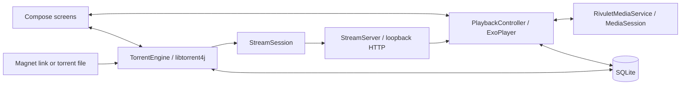

# Architecture

AudioTorrent is a single-module Android app. The source package is `com.example.rivulet`; `RivuletApp` wires the application container, torrent engine, database, stream server, and playback controller.

## Playback flow

`StreamSession` maps file offsets to torrent pieces and schedules a read-ahead window. `StreamServer` is a custom socket-based HTTP range server bound to `127.0.0.1`, with a per-server token in stream URLs. ExoPlayer consumes that local stream. MP4/M4B tail pieces receive additional priority to help load metadata.

`PlaybackController` coordinates playback requests, chapter queues, resume positions, bookmarks, speed, and sleep timers. `RivuletMediaService` connects playback to Android's foreground media service and system media controls.

## Source map

Paths below are relative to [`app/src/main/java/com/example/rivulet/`](../app/src/main/java/com/example/rivulet/).

| Location | Responsibility |
| --- | --- |
| `MainActivity.kt` | Entry point and incoming Android intents |
| `RivuletApp.kt` | Application container and dependency wiring |
| `Navigation.kt`, `NavigationKeys.kt` | Screen navigation |
| `torrent/` | libtorrent4j integration, torrent lifecycle, and download priorities |
| `stream/` | Piece scheduling and the loopback HTTP bridge |
| `playback/` | ExoPlayer controller and MediaSession service |
| `data/TorrentDatabase.kt` | SQLite library, progress, history, bookmarks, and related state |
| `data/audiobookbay/` | Third-party discovery client and HTML parsing |
| `data/lyrics/` | Companion-text extraction, parsing, timing, and caching |
| `ui/`, `theme/` | Compose screens, formatting, and visual theme |

## Dependencies and native code

Versions are defined in [`gradle/libs.versions.toml`](../gradle/libs.versions.toml). App configuration and dependencies are in [`app/build.gradle.kts`](../app/build.gradle.kts).

The app uses Android SQLite directly. Native libtorrent4j binaries for `arm64-v8a` and `x86_64` live in [`app/src/main/jniLibs/`](../app/src/main/jniLibs/).

## Tests

Local tests live in [`app/src/test/`](../app/src/test/); device tests live in [`app/src/androidTest/`](../app/src/androidTest/). Build commands are in [Building](BUILDING.md). Successful unit tests alone do not establish streaming or background-playback behavior on a device.
